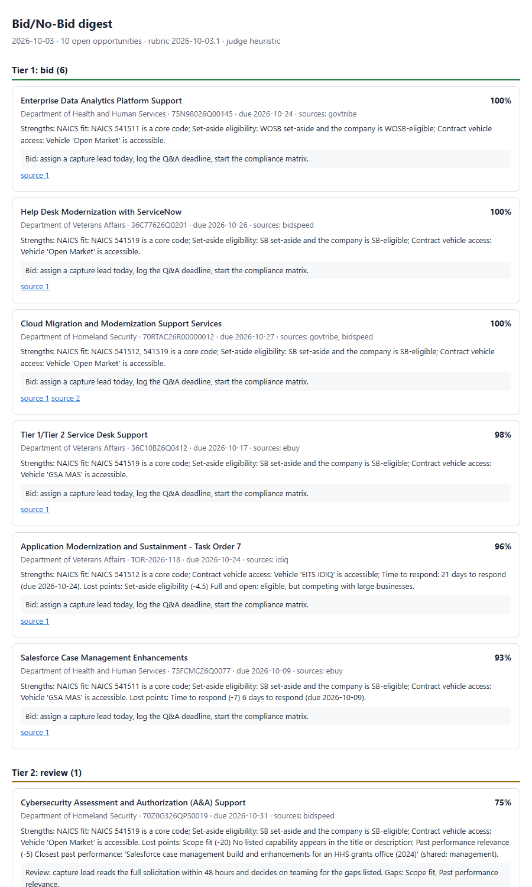

# Govcon Bid/No-Bid

Turns government-contracting alert emails into a scored, de-duplicated pipeline:

```
Gmail label ──► parse (GovTribe · BidSpeed · GSA eBuy · partner IDIQ portal)
            ──► merge duplicates on solicitation number ──► Postgres (system of record) ──► Monday.com
            ──► score against an editable YAML rubric (rules + Claude judgment) ──► Tier 1/2/3
            ──► 07:30 ET digest (Slack/HTML) + same-day Tier 1 alerts
```



**Status:** milestones 1 and 2 are working end to end on sanitized sample emails, with 23 passing
tests. The milestone 3 backtest harness is built. It currently runs on a synthetic 20-decision set
and reaches 85% agreement with the offline judge. The real number comes from the client's own 20
past decisions.

## Quick start (no accounts needed)

```bash
pip install -r requirements.txt
AS_OF=2026-10-03 python -m bidscore run        # intake + score + Monday outbox + Tier 1 alerts
AS_OF=2026-10-03 python -m bidscore digest     # writes out/digest-YYYY-MM-DD.html
python -m bidscore backtest                    # agreement with past human decisions
python -m bidscore serve                       # API at http://127.0.0.1:8000/docs
python -m pytest -q
```

With no credentials, every integration runs in a safe local mode:

| Integration | With credentials | Without |
|---|---|---|
| Gmail intake | `MAILBOX=gmail`, `GMAIL_QUERY="label:bid-alerts newer_than:3d"` | reads `samples/emails/*.eml` |
| Claude judge | `ANTHROPIC_API_KEY` set | transparent keyword judge |
| Monday.com | `MONDAY_API_TOKEN`, `MONDAY_BOARD_ID` | payloads to `out/monday_outbox.jsonl` |
| Slack digest/alerts | `SLACK_WEBHOOK_URL` | `out/digest-*.html`, `out/alerts.log` |
| Database | `DATABASE_URL=postgresql+psycopg://…` | SQLite file |

## Design decisions

### Intake: deterministic parsers first, LLM only as a fallback
Each source has a small parser (`bidscore/parsers/`) that reads its alert template. Parsers are free,
fast and unit-tested. If a source changes its template, or an alert is missing a required field,
that email goes to `extract.py`. Claude extracts the same fields with a strict JSON schema, and the
result passes through the same normalization and merge code. Intake is idempotent: every Gmail
message ID is recorded, so overlapping hourly runs never double-count.

### Merging duplicates
1. **Normalize the solicitation number.** `70RTAC-26-R-00000012`, `70rtac26r00000012` and
   `70RTAC26R00000012 (Amendment 0002)` all become `70RTAC26R00000012`. Amendments therefore merge
   into the original record instead of creating a new one.
2. **Source-specific IDs are aliases.** eBuy has its own RFQ ID, but the agency's solicitation number
   (the "Reference #") is the merge key. The RFQ ID is kept on the source reference for traceability.
3. **Fuzzy fallback.** When no number is printed, records match on a title-similarity ratio of at
   least 0.88, the same response date and the same agency. Fuzzy merges are flagged `needs_review`
   for a human.
4. **Field precedence.** eBuy and the IDIQ portal are the contracting office's own systems, so they
   beat the aggregators on conflicts. A newer alert always wins on the deadline, because amendments
   move dates. Every disagreement is kept in `conflicts`, so nothing is silently overwritten.
5. **Nothing is lost.** Every alert that mentioned an opportunity is kept as a `SourceRef` row, with
   its link and raw fields.

### Consistent, explainable LLM scoring
Current Claude models no longer accept `temperature`, so consistency is designed in:
- **Rules where rules work.** NAICS fit, set-aside eligibility, vehicle access, response runway,
  agency relationship and place of performance are computed in Python from the structured fields.
- **Anchored levels for judgment.** Claude scores only the criteria that need reading
  comprehension: scope fit and past-performance relevance. It picks one of three written anchors
  (0/50/100) and must quote its evidence. It never invents a number.
- **Cache.** Each judgment is cached under the key (model, rubric version, exact prompt). The same
  opportunity scored twice gives the same answer. Editing the rubric bumps its version, which
  triggers a clean re-score.
- **Arithmetic in code.** The weighted total, tier cut-offs (90 / 70), knockouts and recommended
  action are deterministic. Each score's rationale lists its strengths and the points lost per
  criterion.
- **Knockouts.** An ineligible set-aside, a vehicle the company doesn't hold, an excluded work type
  or a passed deadline forces Tier 3 with the reason, whatever the score.
- **Degrades, never fails.** If the API is down or rate-limited, that run uses the offline judge and
  labels it, and the next run catches up. A refusal fallback is enabled on the API call.

Change criteria, weights, anchors, tiers or the company profile in `config/rubric.yaml`. No code
changes are needed. Weights are validated to sum to 100.

### Backtest (milestone 3)
`python -m bidscore backtest` scores each past opportunity *as of its decision date* and compares
the result with the human call. It prints the agreement %, a confusion matrix, every disagreement
with its rationale, and a threshold sweep, so the Tier 2 cut-off is set from the client's own
history instead of guessed.

Current output on the synthetic set, with the offline judge:

```
agreement=85.0%  confusion: bid/bid 8 · bid/no-bid 1 · no-bid/bid 2 · no-bid/no-bid 9
threshold sweep: 70 → 85% · 80 → 90%
```

The three misses are genuine judgment calls: on-site work in a city without staff, a COBOL skills
gap, and a call center under a non-core NAICS code. That is the gap the Claude judge and a short
"bid strategy notes" field in the rubric are meant to close.

## Layout

```
config/rubric.yaml        editable criteria, weights, anchors, company profile
bidscore/parsers/         one parser per alert source
bidscore/intake.py        idempotent intake + duplicate merging
bidscore/extract.py       Claude fallback extraction for unknown formats
bidscore/scoring.py       rule criteria, Claude/heuristic judges, tiering, rationale
bidscore/llm.py           structured-output call, refusal fallback, result cache
bidscore/monday.py        one-way, idempotent Monday.com push
bidscore/digest.py        daily digest + Tier 1 alerts
bidscore/scheduler.py     hourly intake (business hours ET) + 07:30 digest
bidscore/api.py           FastAPI: /opportunities, /run/intake, /digest/preview, /backtest
bidscore/backtest.py      agreement with past decisions + threshold sweep
samples/                  sanitized sample alerts (synthetic) and past decisions (synthetic)
tests/                    23 tests: parsers, normalization, merge, idempotency, scoring, backtest
```

## Production notes
- Deploy as one small container: `python -m bidscore schedule` for the jobs and `serve` for the API.
  Postgres via `DATABASE_URL`.
- The Gmail scope is read-only (`gmail.readonly`). The Monday token needs write access to one board.
- Monday column IDs are mapped in `bidscore/monday.py:COLUMNS`. Set them once the board exists.
- The partner portal's sending domain is configured with `IDIQ_PORTAL_DOMAIN`.
